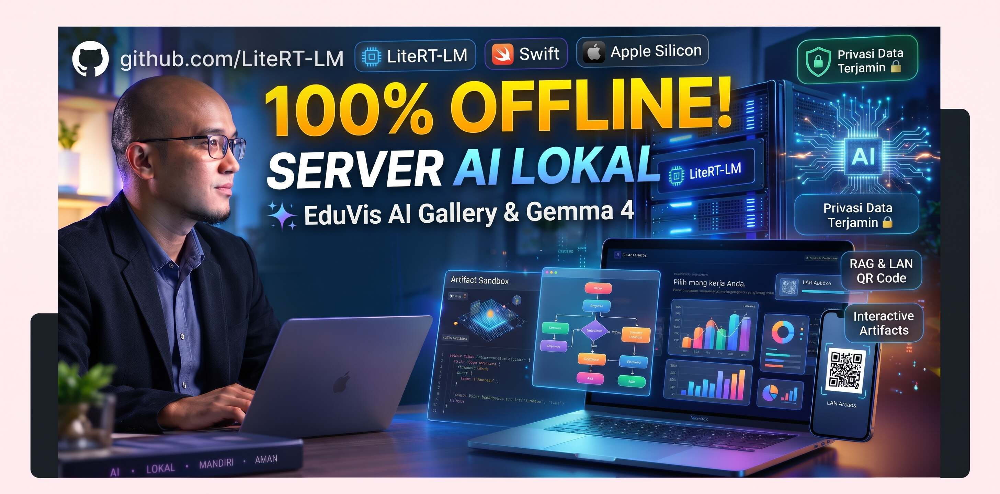

# 🚀 Chrome On-Device AI Playground (V2.0.0)

<div align="center">
  <p>
    <b>🇮🇩 Bahasa Indonesia | <a href="README_EN.md">🇬🇧 English</a></b>
  </p>
  
  <p><em>Kumpulan eksperimen dan purwarupa (prototype) aplikasi AI Client-Side yang berjalan 100% secara lokal di dalam browser Anda, tanpa server backend eksternal, tanpa biaya API, dan dengan jaminan privasi data penuh.</em></p>
  <p>
    <a href="CHANGELOG.md"><b>📋 Lihat Catatan Rilis (Changelog)</b></a>
  </p>
</div>

---

## 📑 Daftar Isi
- [🚀 Chrome On-Device AI Playground (V2.0.0)](#-chrome-on-device-ai-playground-v200)
  - [📑 Daftar Isi](#-daftar-isi)
  - [✨ Gambaran Umum](#-gambaran-umum)
  - [📂 Struktur & Modul Proyek](#-struktur--modul-proyek)
    - [1. `index.html` (Portal & Landing Page)](#1-indexhtml-portal--landing-page)
    - [2. `mesin-litert-lm.html` (WebGPU LiteRT-LM Engine)](#2-mesin-litert-lmhtml-webgpu-litert-lm-engine)
    - [3. `obrolan-claude.html` (Multi-Provider Chat Interface)](#3-obrolan-claudehtml-multi-provider-chat-interface)
    - [4. `analisis-vision.html` & `analisis-kode.html` (Vision & Code Analysis)](#4-analisis-visionhtml--analisis-kodehtml-vision--code-analysis)
    - [5. `percakapan-gemini-live.html` (Voice & Multimodal Interface)](#5-percakapan-gemini-livehtml-voice--multimodal-interface)
  - [🧠 In-Browser RAG & Vector Knowledge Base](#-in-browser-rag--vector-knowledge-base)
  - [🌐 LAN AI Relay & Bridge Server (Akses via HP/Tablet)](#-lan-ai-relay--bridge-server-akses-via-hptablet)
  - [🖥️ Peluncur & Otomasi macOS](#️-peluncur--otomasi-macos)
    - [1. macOS Native Swift GUI Launcher (`jalankanserverFN.command`)](#1-macos-native-swift-gui-launcher-jalankanserverfncommand)
    - [2. Skrip Push Sekali Klik (`git_push.command`)](#2-skrip-push-sekali-klik-git_pushcommand)
  - [🛠️ Arsitektur & Teknologi](#️-arsitektur--teknologi)
  - [🚀 Prasyarat & Cara Menjalankan](#-prasyarat--cara-menjalankan)
    - [Langkah 1: Konfigurasi Chrome Flags](#langkah-1-konfigurasi-chrome-flags)
    - [Langkah 2: Menjalankan Server Lokal](#langkah-2-menjalankan-server-lokal)
  - [⚙️ Panduan Pengaturan Mode AI (Multi-Provider)](#️-panduan-pengaturan-mode-ai-multi-provider)
  - [🐛 Troubleshooting](#-troubleshooting)
  - [🤝 Kontribusi](#-kontribusi)
  - [📄 Lisensi](#-lisensi)

---

## ✨ Gambaran Umum

Repositori ini adalah sebuah _playground_ untuk mengeksplorasi batas kemampuan **Browser-based AI**. Dengan memanfaatkan standar web mutakhir seperti **WebGPU** dan **Chrome Built-in AI (Prompt API)**, repositori ini mendemonstrasikan bahwa model bahasa besar (LLM) dapat berjalan langsung di perangkat keras pengguna (GPU/NPU lokal) dengan latensi yang sangat rendah.

**Keunggulan Utama:**
* **Privasi Maksimal (100% Offline):** Semua pemrosesan prompt, analisis dokumen, dan obrolan dilakukan langsung di memori perangkat Anda. Tidak ada data yang dikirim ke server cloud pihak ketiga.
* **Performa Hardware-Accelerated:** Menggunakan WebGPU untuk memanfaatkan akselerasi GPU/NPU perangkat secara langsung.
* **Arsitektur Tanpa Server Eksternal (Serverless Client-Side):** Antarmuka murni dibangun menggunakan HTML5, modern CSS3, dan Vanilla JavaScript ES Modules.
* **Dukungan Akses Multi-Device (LAN Bridge):** Host PC/Mac dapat membagikan kemampuan AI lokal ke perangkat smartphone/tablet di jaringan Wi-Fi yang sama melalui koneksi aman ber-SSL HTTPS.

---

## 📂 Struktur & Modul Proyek

Setiap berkas `.html` dalam repositori ini bertindak sebagai sebuah *Single-Page Application (SPA)* mandiri yang mendemonstrasikan kapabilitas teknologi AI tertentu:

### 1. `index.html` (Portal & Landing Page)
Halaman sentral untuk menelusuri seluruh varian aplikasi AI yang tersedia.
* Memeriksa dukungan Chrome Prompt API dan status ketersediaan model lokal secara otomatis saat dibuka.
* Mendukung pergantian tema gelap/terang (*Dark/Light Mode*) yang tersimpan di local storage browser.
* Dilengkapi galeri visual interaktif dan kartu pratinjau antarmuka untuk tiap modul.

### 2. `mesin-litert-lm.html` (WebGPU LiteRT-LM Engine)
Implementasi *state-of-the-art* dari inferensi WebGPU menggunakan framework terbaru Google.
* **Teknologi:** `@litert-lm/core` (Utama) dan `@mediapipe/tasks-genai` (Fallback).
* **Fitur:** 
  * Memuat model bahasa berformat `.litertlm` (seperti *Gemma 4 E2B Instruct*) langsung dari File System lokal atau diunduh dari Hugging Face.
  * Realtime progress bar saat mengunduh bobot model.
  * Pipeline inferensi langsung memanfaatkan VRAM GPU untuk streaming respons berkecepatan tinggi.

### 3. `obrolan-claude.html` (Multi-Provider Chat Interface)
Antarmuka obrolan tingkat profesional dengan dukungan multi-penyedia model.
* **Teknologi:** Google Chrome Built-in AI (`window.ai`), Ollama REST API, OpenAI-compatible API.
* **Fitur:**
  * **Multi-Provider Switcher:** Beralih dengan mulus antara model lokal bawaan Chrome (Gemini Nano), Ollama lokal (Llama 3, Mistral, dll), maupun Endpoint kustom (LM Studio / OpenAI).
  * **Interactive Mermaid & Math Renderers:** Diagram alur Mermaid dengan kontrol zoom/pan/export (`ai-mermaid-controls.js`) serta render KaTeX untuk rumus matematis.
  * **Penyimpanan Sesi Permanen:** Percakapan disimpan secara aman di IndexedDB, lengkap dengan fitur pencarian riwayat obrolan (`session-search.js`) serta ekspor ke format PDF, DOCX, TXT, dan JSON.

### 4. `analisis-vision.html` & `analisis-kode.html` (Vision & Code Analysis)
Spesialisasi untuk analisis gambar multimodal dan penelaahan kode program.
* **Fitur:** Aksi Cepat (*Quick Action*) untuk *Code Review*, *Refactor*, penerjemahan bahasa, pembuatan rangkuman instan, serta integrasi editor CodeMirror.

### 5. `percakapan-gemini-live.html` (Voice & Multimodal Interface)
Antarmuka eksperimental untuk percakapan interaktif dengan dukungan audio visual realtime.

---

## 🧠 In-Browser RAG & Vector Knowledge Base

Modul aplikasi utama dilengkapi dengan sistem **Retrieval-Augmented Generation (RAG)** yang sepenuhnya berjalan di sisi klien:
1. **Parsing Dokumen:** Mendukung dokumen `.pdf` (via PDF.js), `.docx` (via Mammoth.js), `.txt`, dan `.md`.
2. **Chunking & Embedding Lokal:** Teks dipecah dengan teknik *overlapping* dan diubah menjadi vektor menggunakan `Transformers.js` dengan model embedding lokal berkecepatan tinggi:
   - `intfloat/multilingual-e5-small` (113 MB via Git LFS untuk dokumen multibahasa/Bahasa Indonesia presisi tinggi).
   - `Xenova/all-MiniLM-L6-v2` (22 MB untuk embedding ringan dan cepat).
3. **Penyimpanan & Pencarian Vektor:** Vektor disimpan di IndexedDB secara permanen. Pertanyaan pengguna dicocokkan menggunakan kalkulasi *cosine similarity* secara lokal dan konteks terbaik otomatis disuntikkan ke prompt AI.

---

## 🌐 LAN AI Relay & Bridge Server (Akses via HP/Tablet)

Ingin menggunakan AI di ponsel atau tablet tanpa menginstal model di perangkat seluler tersebut?
Playground ini dilengkapi sistem **LAN AI Bridge & WebSocket Relay**:
1. Komputer host (Mac/PC) menjalankan model AI lokal dan bertindak sebagai server pemrosesan.
2. Skrip peluncur otomatis membuat sertifikat SSL (`cert.pem` & `key.pem`) sehingga koneksi HTTPS lokal dapat diakses aman oleh peramban modern di ponsel.
3. Cukup klik tombol **QR HP** di halaman aplikasi apa pun dan pindai menggunakan kamera ponsel Anda untuk langsung berinteraksi dengan AI host!

---

## 🖥️ Peluncur & Otomasi macOS

Untuk kenyamanan pengguna macOS, telah disediakan skrip otomatisasi sekali klik:

### 1. macOS Native Swift GUI Launcher (`jalankanserverFN.command`)
* Peluncur native yang dikompilasi secara otomatis menggunakan `swiftc` dari sumber kode [jalankanserverFN_gui.swift](jalankanserverFN_gui.swift).
* Menyediakan panel kontrol visual untuk menyalakan/mematikan server, memantau status SSL HTTPS, memeriksa port aktif, melihat QR code LAN, dan membaca log server secara realtime.

### 2. Skrip Push Sekali Klik (`git_push.command`)
* Skrip sekali klik untuk mempermudah pembaruan proyek ke repositori GitHub.
* Otomatis mendeteksi perubahan, mengemas commit dengan timestamp atau pesan khusus, dan melakukan push ke GitHub tanpa perlu mengetik ulang password/token karena telah terintegrasi dengan macOS Keychain.

---

## 🛠️ Arsitektur & Teknologi

* **Frontend:** HTML5, CSS3 Responsif (Vanilla dengan CSS Variables), Vanilla JavaScript (ES Modules).
* **AI & Machine Learning Engine:**
  * [Chrome Prompt API](https://github.com/WICG/prompt-api) (`window.ai` / Gemini Nano)
  * [LiteRT-LM](https://github.com/google-ai-edge/LiteRT-LM) (`@litert-lm/core`) via WebGPU
  * [Transformers.js](https://huggingface.co/docs/transformers.js/index) (untuk eksekusi model *embedding* offline di browser)
  * [Git LFS](https://git-lfs.github.com/) (mengelola berkas bobot model ONNX besar secara efisien)
* **Penyimpanan Data Lokal:** IndexedDB (`ClaudeChatDB` dan database vektor RAG).
* **Visual & Code Renderers:** Mermaid.js (dengan kontrol kustom), Chart.js, KaTeX, CodeMirror, Prism.js, Marked.js.
* **Server & Relay:** Python 3 HTTP Server, Node.js WebSocket Relay, Swift Native macOS App.

---

## 🚀 Prasyarat & Cara Menjalankan

Karena berinteraksi dengan API eksperimental (WebGPU, Prompt API, dan penyimpanan memori lokal), aplikasi ini wajib dijalankan melalui HTTP/HTTPS server lokal (bukan via protokol `file:///`).

### Langkah 1: Konfigurasi Chrome Flags
1. Buka browser Google Chrome desktop (disarankan versi Chrome Dev / Canary terbaru).
2. Akses `chrome://flags` dan aktifkan:
   * **Optimization Guide On Device Model:** Ubah ke `Enabled BypassPerfRequirement`
   * **Prompt API for Gemini Nano:** Ubah ke `Enabled`
   * **Enables WebGPU:** Aktifkan (*Enabled*).
3. Klik tombol **Relaunch** di pojok kanan bawah.
4. Buka tab `chrome://components`, cari **Optimization Guide On Device Model**, dan klik **Check for update** untuk memastikan model Gemini Nano telah terunduh.

### Langkah 2: Setup Otomatis Dependensi & Sertifikat SSL

Sebelum menjalankan server untuk pertama kali, jalankan skrip setup otomatis yang sesuai dengan sistem operasi Anda:

* **Pengguna macOS:**
  - Klik ganda berkas `setup_mac.command` di Finder.
  - Atau jalankan di terminal: `./setup.sh`
* **Pengguna Linux:**
  - Buka terminal dan jalankan: `bash setup.sh`
* **Pengguna Windows:**
  - Klik ganda berkas `setup.bat` di File Explorer.
* **Pengguna Node.js / NPM:**
  - Jalankan: `npm run setup`

> 💡 **Apa yang dilakukan skrip setup?**
> 1. Memeriksa & memasang Node.js, Python 3, OpenSSL, dan Git LFS secara otomatis.
> 2. Men-generate sertifikat SSL (`key.pem` & `cert.pem`) dengan Subject Alternative Name (SAN) untuk `localhost` dan IP LAN Anda.
> 3. Menginisialisasi Git LFS dan memastikan berkas model AI lokal (`.onnx`) telah terunduh penuh.
> 4. Memberikan izin eksekusi (`chmod +x`) untuk seluruh skrip peluncur.

### Langkah 3: Menjalankan Server Lokal

#### Menggunakan Skrip Otomatis (Direkomendasikan):
* **Pengguna Mac (GUI Native Swift):** Klik ganda `jalankanserverFN.command`.
* **Pengguna Mac (CLI Standard):** Klik ganda `start_mac.command` atau `start_lan_mac.command`.
* **Pengguna Windows:** Klik ganda file `start_windows.bat`.

#### Menjalankan Manual via Terminal / NPM:
```bash
# Menggunakan NPM:
npm start

# Menggunakan Python:
python3 -m http.server 8080

# Atau menggunakan Node.js:
npx http-server -p 8080
```
Lalu buka alamat `http://localhost:8080/index.html` (atau `https://localhost:1234` jika relay HTTPS aktif) di browser Anda.

---

## ⚙️ Panduan Pengaturan Mode AI (Multi-Provider)

Melalui menu **Settings** (ikon roda gigi di antarmuka obrolan):
1. **Chrome On-Device (Gemini Nano):** Berjalan 100% offline di RAM komputer, gratis, latensi terendah, privasi absolut.
2. **Ollama (Lokal Server):** Hubungkan ke server Ollama (`http://localhost:11434`) untuk model Llama 3, DeepSeek, Mistral. *(Pastikan environment variable `OLLAMA_ORIGINS="*"` telah diaktifkan)*.
3. **OpenAI / Custom API:** Hubungkan ke OpenAI (GPT-4o) atau server lokal seperti LM Studio (`http://localhost:1234/v1`).

---

## 🐛 Troubleshooting

* **Model Simulasi Aktif di `mesin-litert-lm.html`:** Terjadi jika CDN `@litert-lm/core` mengalami gangguan akses. Aplikasi telah dilengkapi fallback multi-CDN.
* **CORS Error pada Transformers.js:** Pastikan selalu mengakses via `http://localhost:8080` atau alamat IP LAN, bukan dengan membuka file langsung (`file://`).
* **Prompt API Tidak Terdeteksi:** Pastikan Chrome Flags telah diaktifkan dan browser telah di-*relaunch*. Status ketersediaan model juga dapat dipantau di `chrome://on-device-internals`.

---

## 🤝 Kontribusi

Kontribusi selalu diterima! Jika Anda ingin menambahkan integrasi baru, melaporkan perbaikan bug, atau mengoptimalkan antarmuka, silakan buat *Pull Request* atau laporkan melalui menu *Issues*.

---

## 📄 Lisensi

Proyek ini dirilis secara open-source di bawah lisensi [MIT License](https://opensource.org/licenses/MIT).
