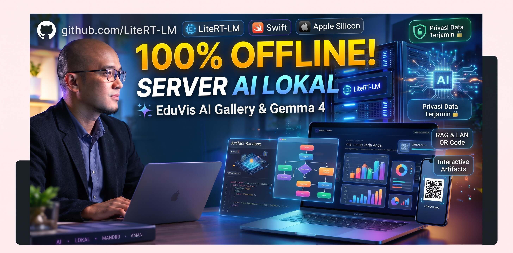

# 🚀 Chrome On-Device AI Playground (V2.1.0)

<div align="center">
  <p>
    <b><a href="README.md">🇮🇩 Bahasa Indonesia</a> | 🇬🇧 English | <a href="README_JV.md">ꦗꦮ Basa Jawa</a></b>
  </p>
  
  <p><em>A collection of experiments and prototype Client-Side AI applications that run 100% locally in your browser, without an external backend server, without API costs, and with guaranteed full data privacy.</em></p>
  <p>
    <a href="CHANGELOG_EN.md"><b>📋 View Release Notes (Changelog)</b></a>
  </p>
</div>

---

## 📑 Table of Contents
- [🚀 Chrome On-Device AI Playground (V2.0.0)](#-chrome-on-device-ai-playground-v200)
  - [📑 Table of Contents](#-table-of-contents)
  - [✨ Overview](#-overview)
  - [📂 Project Structure & Modules](#-project-structure--modules)
    - [1. `index.html` (Portal & Landing Page)](#1-indexhtml-portal--landing-page)
    - [2. `mesin-litert-lm.html` (WebGPU LiteRT-LM Engine)](#2-mesin-litert-lmhtml-webgpu-litert-lm-engine)
    - [3. `obrolan-claude.html` (Multi-Provider Chat Interface)](#3-obrolan-claudehtml-multi-provider-chat-interface)
    - [4. `analisis-vision.html` & `analisis-kode.html` (Vision & Code Analysis)](#4-analisis-visionhtml--analisis-kodehtml-vision--code-analysis)
    - [5. `percakapan-gemini-live.html` (Voice & Multimodal Interface)](#5-percakapan-gemini-livehtml-voice--multimodal-interface)
  - [🧠 In-Browser RAG & Local Vector Knowledge Base](#-in-browser-rag--local-vector-knowledge-base)
  - [🌐 LAN AI Relay & Bridge Server (Mobile/Tablet Access)](#-lan-ai-relay--bridge-server-mobiletablet-access)
  - [🖥️ macOS Launchers & Automation](#️-macos-launchers--automation)
    - [1. macOS Native Swift GUI Launcher (`jalankanserverFN.command`)](#1-macos-native-swift-gui-launcher-jalankanserverfncommand)
    - [2. One-Click Push Script (`git_push.command`)](#2-one-click-push-script-git_pushcommand)
  - [🛠️ Architecture & Technology](#️-architecture--technology)
  - [🚀 Prerequisites & How to Run](#-prerequisites--how-to-run)
    - [Step 1: Configure Chrome Flags](#step-1-configure-chrome-flags)
    - [Step 2: Run Local Server](#step-2-run-local-server)
  - [⚙️ AI Mode Configuration Guide (Multi-Provider)](#️-ai-mode-configuration-guide-multi-provider)
  - [🐛 Troubleshooting](#-troubleshooting)
  - [🤝 Contribution](#-contribution)
  - [📄 License](#-license)

---

## ✨ Overview

This repository is a playground to explore the boundaries of **Browser-based AI**. By leveraging modern web standards like **WebGPU** and **Chrome Built-in AI (Prompt API)**, this project demonstrates that Large Language Models (LLMs) can run directly on consumer-grade hardware (local GPU/NPU) with near-zero latency.

**Key Advantages:**
* **Maximum Privacy (100% Offline):** All prompt processing, document analysis, and conversational chats occur directly in your device's memory. No data is ever transmitted to external cloud servers.
* **Hardware-Accelerated Performance:** Uses WebGPU to directly utilize device GPU/NPU cores.
* **Serverless Client-Side Architecture:** The user interface is built purely using HTML5, modern responsive CSS3, and Vanilla JavaScript ES Modules.
* **Multi-Device LAN Access (Bridge):** A host Mac/PC can share its local AI capabilities with smartphones and tablets on the same local Wi-Fi network through a secure SSL HTTPS connection.

---

## 📂 Project Structure & Modules

Each `.html` file in this repository operates as a self-contained *Single-Page Application (SPA)* demonstrating distinct AI capabilities:

### 1. `index.html`, `index_en.html`, & `index_jv.html` (Tri-Language Portal & Landing Page)
Central landing portal for exploring all on-device AI applications available in 3 languages (Indonesian, English, and Javanese).
* **Welcome Language Modal:** Intelligent modal dialog on first load of `index.html` prompting users for their preferred language with persistent preference saving.
* **3-Way Language Switcher:** Compact topbar dropdown (`[🇮🇩 ID ▾]`, `[🇬🇧 EN ▾]`, `[ꦗꦮ JV ▾]`) housed in a 46px floating pill optimized for mobile screens without stacking.
* **Interactive SVG Pipeline Simulation & Live Metrics:** 4-layer architecture diagram with animated circuit flows and test simulation buttons (`💬 Text & Code`, `📄 RAG Document`, `🖼️ Vision Analysis`), reporting real-time zero-cloud latency and local NPU/GPU metrics.
* **Chrome On-Device AI Educational Narrative:** Deep-dive breakdown of Gemini Nano architecture, 100% local RAM data isolation, and W3C Web Platform AI standards.
* **Lag-Free Multi-OS Quickstart:** Terminal quickstart tabs (macOS, Windows, Linux) with 1-click command copy.
* **Automated Asset Integrity Verification:** Built-in scanner to detect Git LFS stubs and automatically download model bundles (`verify_assets.py`).

### 2. `mesin-litert-lm.html` (WebGPU LiteRT-LM Engine)
State-of-the-art WebGPU inference implementation utilizing Google's latest runtime.
* **Technology:** `@litert-lm/core` (Primary) with `@mediapipe/tasks-genai` (Fallback).
* **Features:** 
  * Loads `.litertlm` formatted language models (e.g., *Gemma 4 E2B Instruct*) directly from the local filesystem or via Hugging Face URLs.
  * Realtime progress tracking during model weight downloads.
  * Inference pipeline utilizes GPU VRAM directly for ultra-fast response streaming.

### 3. `obrolan-claude.html` (Multi-Provider Chat Interface)
Professional-grade conversational interface with multi-provider flexibility.
* **Technology:** Google Chrome Built-in AI (`window.ai`), Ollama REST API, OpenAI-compatible API.
* **Features:**
  * **Multi-Provider Switcher:** Seamlessly toggle between Chrome Built-in AI (Gemini Nano), local Ollama (Llama 3, Mistral, DeepSeek), and custom endpoints (LM Studio / OpenAI).
  * **Interactive Mermaid & Math Renderers:** Dynamic Mermaid flowcharts with custom zoom/pan/export controls (`ai-mermaid-controls.js`) and KaTeX math typesetting.
  * **Persistent Storage & Search:** Chats are stored locally in IndexedDB with cross-session search (`session-search.js`) and multi-format exports (PDF, DOCX, TXT, JSON).

### 4. `analisis-vision.html` & `analisis-kode.html` (Vision & Code Analysis)
Specialized tools for multimodal image understanding and source code inspection.
* **Features:** Quick Actions for Code Review, Refactoring, translation, instant summaries, and integrated CodeMirror syntax editors.

### 5. `percakapan-gemini-live.html` (Voice & Multimodal Interface)
Experimental voice conversation and multimodal interaction canvas.

---

## 🧠 In-Browser Advanced RAG & Vector Knowledge Base

The core modules (`obrolan-claude-rag.html` and `analisis-vision-rag.html`) feature state-of-the-art **Retrieval-Augmented Generation (RAG)** running 100% client-side:
1. **Dual Embedding Model Selector:**
   - `Xenova/all-MiniLM-L6-v2` (22 MB): Rapid, lightweight, and memory-efficient.
   - `intfloat/multilingual-e5-small` (118 MB): High-accuracy multilingual embedding with 1-click re-indexing.
2. **Smart Header-Aware Chunking:** Preserves Markdown heading structure (`#`, `##`, `###`) and PDF document page numbers.
3. **Hybrid Search Engine:** Fuses *Cosine Similarity* (65% weight) with *Lexical BM25 Keyword Search* (35% weight) for superior retrieval precision.
4. **Accurate Source Citations:** Page-level pill tags (`p. X`) accompanied by transparent hybrid relevance scoring.
5. **Strict Anti-Hallucination Toggle:** Constrains generation strictly to retrieved context, preventing AI hallucinations.

---

## 🌐 LAN AI Relay & Bridge Server (Mobile/Tablet Access)

Want to use local AI from your phone or tablet without loading heavy models on mobile devices?
This project includes a **LAN AI Bridge & WebSocket Relay**:
1. The host machine (Mac/PC) runs the local AI model and functions as an inference hub.
2. The launcher script automatically generates local SSL certificates (`cert.pem` & `key.pem`) to satisfy modern browser HTTPS security requirements on mobile devices.
3. Simply tap the **QR HP** button on any app page and scan the QR code with your mobile camera to interact with the host AI immediately!

---

## 🖥️ macOS Launchers & Automation

To streamline the development and usage experience on macOS, one-click automation scripts are included:

### 1. macOS Native Swift GUI Launcher (`jalankanserverFN.command`)
* A native GUI app compiled automatically via `swiftc` from [jalankanserverFN_gui.swift](jalankanserverFN_gui.swift).
* Features visual controls to toggle servers, monitor SSL HTTPS status, inspect port bindings, generate LAN QR codes, and stream server logs in realtime.

### 2. One-Click Push Script (`git_push.command`)
* An automated double-click bash script in macOS Finder to streamline GitHub sync.
* Detects local modifications, creates timestamped or custom commits, and pushes to GitHub without repeated credential prompts via macOS Keychain integration.

---

## 🛠️ Architecture & Technology

* **Frontend:** HTML5, Responsive CSS3 (CSS Variables for dynamic themes), Vanilla JavaScript (ES Modules).
* **AI & Machine Learning Engine:**
  * [Chrome Prompt API](https://github.com/WICG/prompt-api) (`window.ai` / Gemini Nano)
  * [LiteRT-LM](https://github.com/google-ai-edge/LiteRT-LM) (`@litert-lm/core`) via WebGPU
  * [Transformers.js](https://huggingface.co/docs/transformers.js/index) (for local in-browser embeddings)
  * [Git LFS](https://git-lfs.github.com/) (tracks large ONNX model files)
* **Local Data Storage:** IndexedDB (`ClaudeChatDB` and RAG vector store).
* **Renderers:** Mermaid.js (with custom pan/zoom UI), Chart.js, KaTeX, CodeMirror, Prism.js, Marked.js.
* **Server & Relay:** Python 3 HTTP Server, Node.js WebSocket Relay, Swift Native macOS App.

---

## 🚀 Prerequisites & How to Run

Because this app utilizes experimental web capabilities (WebGPU, Prompt API, high-memory local buffers), it must be served through a local HTTP/HTTPS server (not via `file:///`).

### Step 1: Configure Chrome Flags
1. Open Google Chrome desktop (preferably Chrome Dev / Canary).
2. Navigate to `chrome://flags` and set:
   * **Optimization Guide On Device Model:** `Enabled BypassPerfRequirement`
   * **Prompt API for Gemini Nano:** `Enabled`
   * **Enables WebGPU:** `Enabled`
3. Click the **Relaunch** button in the bottom right corner.
4. Open `chrome://components`, locate **Optimization Guide On Device Model**, and click **Check for update** to ensure Gemini Nano is downloaded.

### Step 2: Automated Dependency & SSL Setup

Before launching the server for the first time, run the automated setup script for your operating system:

* **macOS Users:**
  - Double-click `setup_mac.command` in Finder.
  - Or run in terminal: `./setup.sh`
* **Linux Users:**
  - Open terminal and run: `bash setup.sh`
* **Windows Users:**
  - Double-click `setup.bat` in File Explorer.
* **Node.js / NPM Users:**
  - Run: `npm run setup`

> 💡 **What does the setup script do?**
> 1. Detects and installs Node.js, Python 3, OpenSSL, and Git LFS automatically.
> 2. Generates self-signed SSL certificates (`key.pem` & `cert.pem`) with Subject Alternative Names (SAN) for `localhost` and your LAN IP.
> 3. Initializes Git LFS and pulls the complete local AI model files (`.onnx`).
> 4. Grants execution permissions (`chmod +x`) to all launcher scripts.

### Step 3: Run Local Server

#### Automated One-Click Scripts (Recommended):
* **Mac Users (Native Swift GUI):** Double-click `jalankanserverFN.command`.
* **Mac Users (Standard CLI):** Double-click `start_mac.command` or `start_lan_mac.command`.
* **Windows Users:** Double-click `start_windows.bat`.

#### Manual Terminal Commands / NPM:
```bash
# Using NPM:
npm start

# Using Python:
python3 -m http.server 8080

# Or using Node.js:
npx http-server -p 8080
```
Then navigate to `http://localhost:8080/index.html` (or `https://localhost:1234` when the HTTPS relay is running) in your browser.

---

## ⚙️ AI Mode Configuration Guide (Multi-Provider)

Via the **Settings** menu (gear icon in chat pages):
1. **Chrome On-Device (Gemini Nano):** Runs 100% offline in RAM, zero API fees, lowest latency, complete privacy.
2. **Ollama (Local Server):** Connects to your Ollama instance (`http://localhost:11434`) for Llama 3, DeepSeek, or Mistral models. *(Ensure `OLLAMA_ORIGINS="*"` is enabled)*.
3. **OpenAI / Custom API:** Connects to cloud providers or local OpenAI-compatible endpoints like LM Studio (`http://localhost:1234/v1`).

---

## 🐛 Troubleshooting

* **Simulation Fallback Active in `mesin-litert-lm.html`:** Occurs if Google's CDN for `@litert-lm/core` is unreachable. The application includes automatic multi-CDN fallbacks.
* **Transformers.js CORS Errors:** Always access the app through `http://localhost:8080` or a local LAN IP, never directly via the filesystem (`file://`).
* **Prompt API Not Detected:** Confirm that flags are enabled and the browser was relaunched. Monitor component state at `chrome://on-device-internals`.

---

## 🤝 Contribution

Contributions are warmly welcomed! Feel free to submit a Pull Request or file an issue to report bugs or propose enhancements.

---

## 📄 License

This project is open-source under the [MIT License](https://opensource.org/licenses/MIT).
